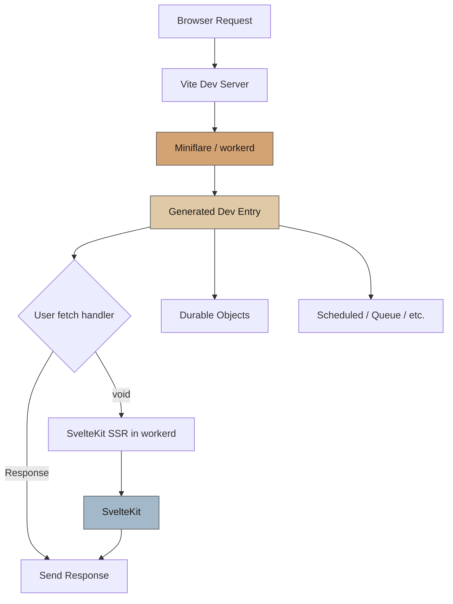
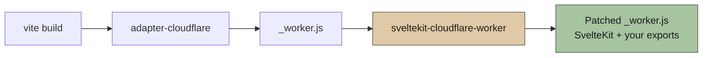

# sveltekit-cloudflare-worker

A Vite plugin for running a SvelteKit app as a full Cloudflare Worker with native bindings,
additional Worker handlers, Durable Objects, Workflows, and Worker Entrypoints.

## Why

Write a `src/worker.ts` alongside your SvelteKit app. Export Worker handlers and classes from that
file; the plugin wires them into dev and production builds.

## Setup

### Install

```bash
npm install -D sveltekit-cloudflare-worker @sveltejs/adapter-cloudflare @cloudflare/vite-plugin wrangler esbuild @cloudflare/workers-types
```

`@cloudflare/vite-plugin` is required for the local `workerd` dev path. `wrangler` is used to read
`wrangler.jsonc` for generated types and build output patching. `esbuild` is used to inspect and
bundle your `src/worker.ts` exports.

For the workerd SSR path, the guarded baseline is SvelteKit `>= 2.67`, Vite `>= 8.0`, and
`@cloudflare/vite-plugin >= 1.42`.

### Configure Vite

```ts
// vite.config.ts
import { sveltekit } from '@sveltejs/kit/vite';
import { cloudflareWorker } from 'sveltekit-cloudflare-worker';
import { defineConfig } from 'vite';

export default defineConfig({
	plugins: [sveltekit(), cloudflareWorker()]
});
```

### Configure SvelteKit

Use the Cloudflare adapter normally:

```js
// svelte.config.js
import adapter from '@sveltejs/adapter-cloudflare';

export default {
	kit: {
		adapter: adapter()
	}
};
```

### Create your worker file

```ts
// src/worker.ts
import type { WorkerFetch, WorkerScheduled } from 'sveltekit-cloudflare-worker';
import { DurableObject } from 'cloudflare:workers';

interface Env {
	MY_DO: DurableObjectNamespace<MyDurableObject>;
	ASSETS: Fetcher;
}

export const fetch: WorkerFetch<Env> = async (req, env, ctx, next) => {
	const url = new URL(req.url);

	if (url.pathname === '/api/do') {
		const stub = env.MY_DO.get(env.MY_DO.idFromName('test'));
		const message = await stub.sayHello();
		return Response.json({ message });
	}

	if (url.pathname.startsWith('/api/')) {
		return new Response('custom API response');
	}

	// Return nothing → request falls through to SvelteKit
	// Or call next() to get SvelteKit's response and transform it
};

export const scheduled: WorkerScheduled<Env> = async (controller, env, ctx) => {
	console.log('cron triggered:', controller.cron);
};

export class MyDurableObject extends DurableObject<Env> {
	async sayHello(): Promise<string> {
		return 'Hello from Durable Object!';
	}
}
```

### TypeScript

Use Cloudflare's runtime types for Worker APIs:

```jsonc
{
	"compilerOptions": {
		"types": ["@cloudflare/workers-types"]
	}
}
```

The plugin reads `wrangler.jsonc` and writes a managed block to `src/app.d.ts` with:

- `Cloudflare.Env`
- global `Env`
- `App.Platform.env`

That means SvelteKit server code gets typed `platform.env` bindings automatically:

```ts
export const load = ({ platform }) => {
	platform?.env.DB; // D1Database
};
```

These are compile-time types, not a runtime shim. SvelteKit server code runs inside workerd during
`vite dev`, so `platform.env` receives the native Worker bindings from `wrangler.jsonc`.

Keep your own `App` declarations outside the managed block:

```ts
// <sveltekit-cloudflare-worker>
// generated
// </sveltekit-cloudflare-worker>
```

Set `typesFile: false` to disable this, or pass a custom declaration path.

### Configure Wrangler

Standard `wrangler.jsonc` — add bindings for DOs, KV, D1, etc. as usual:

```jsonc
{
	"name": "my-app",
	"main": ".svelte-kit/cloudflare/_worker.js",
	"compatibility_date": "2025-01-01",
	"compatibility_flags": ["nodejs_compat"],
	"assets": {
		"binding": "ASSETS",
		"directory": ".svelte-kit/cloudflare"
	},
	"durable_objects": {
		"bindings": [{ "name": "MY_DO", "class_name": "MyDurableObject" }]
	},
	"migrations": [{ "tag": "v1", "new_sqlite_classes": ["MyDurableObject"] }]
}
```

### Runtime boundary

`src/worker.ts` is always the Worker boundary: your handler receives native Cloudflare bindings, can
short-circuit requests, and can fall through to SvelteKit when it returns nothing or calls `next()`.

SvelteKit server routes and loads also receive native bindings through `event.platform.env` during
`vite dev`.

### Deferred cleanup

Handlers receive a wrapped `ctx.waitUntil` with an extra `last()` method. Use it for cleanup that
must start after other `waitUntil` promises have settled, such as closing a database connection:

```ts
export const fetch: WorkerFetch<Env> = async (req, env, ctx, next) => {
	const db = connect(env.DB);

	ctx.waitUntil(updateAnalytics(db));
	ctx.waitUntil.last(() => db.close());

	return next();
};
```

`last()` accepts a function, not a Promise. A Promise starts immediately, so
`ctx.waitUntil.last(db.close())` cannot guarantee deferred execution.

## Supported exports

### Handlers

| Export       | Type                    | Description                                                                         |
| ------------ | ----------------------- | ----------------------------------------------------------------------------------- |
| `fetch`      | `WorkerFetch<Env>`      | Runs before SvelteKit. Return `Response`, `void` to fall through, or call `next()`. |
| `scheduled`  | `WorkerScheduled<Env>`  | Cron trigger handler                                                                |
| `queue`      | `WorkerQueue<Env>`      | Queue consumer handler                                                              |
| `email`      | `WorkerEmail<Env>`      | Email routing handler                                                               |
| `tail`       | `WorkerTail<Env>`       | Tail worker handler                                                                 |
| `trace`      | `WorkerTrace<Env>`      | Trace handler                                                                       |
| `tailStream` | `WorkerTailStream<Env>` | Tail stream handler                                                                 |

### Classes

Any exported class is re-exported from the final worker:

- **Durable Objects** (`extends DurableObject`)
- **Workflows** (`extends WorkflowEntrypoint`)
- **Worker Entrypoints** (`extends WorkerEntrypoint`) — named exports only, the default export is managed by the plugin

## Options

```ts
cloudflareWorker({
	workerFile: 'src/worker.ts', // default
	typesFile: 'src/app.d.ts', // default; set false to disable
	verbose: false // default
});
```

## Examples

### Using Hono

Mount a Hono app for your API routes and let everything else fall through to SvelteKit:

```bash
npm install hono
```

```ts
// src/worker.ts
import type { WorkerFetch } from 'sveltekit-cloudflare-worker';
import { Hono } from 'hono';

interface Env {
	DB: D1Database;
}

const api = new Hono<{ Bindings: Env }>()
	.basePath('/api')
	.get('/users', async (c) => {
		const users = await c.env.DB.prepare('SELECT * FROM users').all();
		return c.json(users.results);
	})
	.post('/users', async (c) => {
		const { name } = await c.req.json();
		await c.env.DB.prepare('INSERT INTO users (name) VALUES (?)').bind(name).run();
		return c.json({ ok: true }, 201);
	});

export const fetch: WorkerFetch<Env> = async (req, env, ctx, next) => {
	const res = await api.fetch(req, env, ctx);
	// Hono returns 404 for unmatched routes — fall through to SvelteKit
	if (res.status === 404) return;
	return res;
};
```

### Transforming SvelteKit responses

Use `next()` to call SvelteKit and modify the response — add headers, transform the body, etc:

```ts
// src/worker.ts
import type { WorkerFetch } from 'sveltekit-cloudflare-worker';

export const fetch: WorkerFetch = async (req, env, ctx, next) => {
	const url = new URL(req.url);

	// Handle API routes directly
	if (url.pathname.startsWith('/api/')) {
		return new Response('handled by worker');
	}

	// For everything else, let SvelteKit handle it but add security headers
	const res = await next();
	const headers = new Headers(res.headers);
	headers.set('X-Frame-Options', 'DENY');
	headers.set('X-Content-Type-Options', 'nosniff');
	headers.set('Referrer-Policy', 'strict-origin-when-cross-origin');
	headers.set('Permissions-Policy', 'camera=(), microphone=(), geolocation=()');
	return new Response(res.body, { status: res.status, headers });
};
```

## How it works

### Dev mode

The plugin wraps `@cloudflare/vite-plugin` to run your worker inside a real `workerd` runtime via Miniflare. It generates a dev entry that re-exports your classes, wraps your `fetch`, and re-exports other handlers directly.

Fallthrough requests run SvelteKit SSR inside the Cloudflare Vite `ssr` environment. SvelteKit
server code receives same-worker bindings through `event.platform.env` during local dev:

```ts
// vite.config.ts
cloudflareWorker();
```

`next()` passes native `{ env, ctx, caches, cf }` into `event.platform`.



### Workerd SSR dev path

The workerd SSR dev path makes bindings defined in `wrangler.jsonc` available from SvelteKit server
code in local dev and from `src/worker.ts`.

SvelteKit remote functions (`*.remote.ts` / `*.remote.js`) under the app source are added to the
generated dev manifest with the same remote IDs SvelteKit uses.

In dev, requests flow through:

1. The plugin asks `@cloudflare/vite-plugin` to run the Vite `ssr` environment inside workerd.
2. The plugin generates `.svelte-kit/cloudflare-worker/_dev-entry.ts`, which re-exports your Worker classes
   and calls your `fetch` first.
3. The plugin generates `.svelte-kit/cloudflare-worker/_sveltekit-dev-ssr.ts`, a Worker-side SvelteKit
   responder.
4. When your `fetch` returns nothing or calls `next()`, the generated entry calls that responder.
5. The responder creates SvelteKit's `Server` inside workerd and calls `server.respond()` with:

```ts
platform: {
	env,
	ctx,
	context: ctx,
	caches,
	cf: request.cf
}
```

That means a SvelteKit `+server.ts` route can do this in dev:

```ts
export const GET = async ({ platform }) => {
	const id = platform.env.MY_DO.idFromName('demo');
	const count = await platform.env.MY_DO.get(id).increment();
	return Response.json({ count });
};
```

The integration harness starts a real `vite dev` fixture and checks:

- Worker realm Durable Object access;
- SvelteKit realm `platform.env` Durable Object access;
- SvelteKit remote function execution with `platform.env`;
- SvelteKit `$app/server.read()` for source assets imported with Vite asset URLs;
- SvelteKit dev CSS inlining for route CSS imports, component `<style>` blocks, and dynamic CSS
  imports reached during universal `load`;
- SvelteKit matchers and 404 rendering;
- `ssr = false` route handling without importing browser-only universal modules;
- static asset reads;
- endpoint HMR;
- workerd startup and request handling.

Run it with:

```bash
npm run test:integration
```

#### Caveats

- Dev SSR generation only runs during `vite dev`. Production builds use
  `@sveltejs/adapter-cloudflare` output patched by this plugin.
- It relies on SvelteKit private dev internals (`load_config`, `sync.create`, and the dev SSR
  manifest shape). The plugin guards supported package versions and fails early when those internals
  move.
- Dev CSS inlining is resolved through a private Vite middleware that walks the same SSR module graph
  shape SvelteKit uses for `inline_styles`, then asks Vite's CSS transform for the `?inline`
  payloads.
- Durable Object RPC is covered by the integration test. Workflows can appear in `platform.env`, but
  workflow behavior should be tested against your app because Cloudflare's local Workflow support
  has separate limits.

### Build mode

At build time, the plugin runs after `@sveltejs/adapter-cloudflare`. It bundles `src/worker.ts` with esbuild and patches the generated `_worker.js` to include your handler exports and class re-exports.



## Verification

The dev SSR implementation relies on SvelteKit private dev internals. It is guarded by version
checks and covered by an integration harness:

```bash
npm run test:integration
```

## License

MIT
