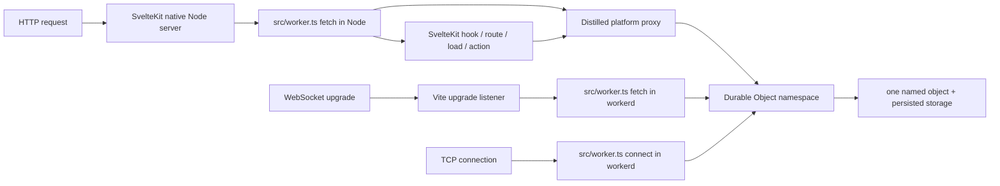

# sveltekit-cloudflare-worker

Add a Cloudflare Worker entry to a SvelteKit application without giving up SvelteKit's native
development server and HMR.

Define your Cloudflare code in `src/worker.ts`. Its `fetch` handler can run before and after
SvelteKit, while exported Durable Objects, Workflows, Worker entrypoints, and other handlers become
part of the deployed Worker. SvelteKit server code and `src/worker.ts` share the bindings declared
in `wrangler.jsonc`.

## Features

- **Worker middleware around SvelteKit** — run `src/worker.ts` before SvelteKit, call `next()`, then
  transform the response after SvelteKit.
- **One Durable Object namespace everywhere** — Worker middleware, SvelteKit routes, and WebSockets
  can address the same named object and persisted state.
- **Durable Object WebSockets** — accept browser WebSocket connections locally and in production
  through the same Worker entry.
- **Inbound TCP handlers** — export `connect(socket)` from `src/worker.ts` and route the live socket
  to a Durable Object in the same local workerd and production Worker.
- **Native SvelteKit development** — keep SvelteKit's Node server, routing, SSR, HMR, hooks, remotes,
  and server assets.
- **Automatic Cloudflare bindings** — derive local runtime bindings and TypeScript declarations
  from `wrangler.jsonc`.
- **Cloudflare entrypoint exports** — export Durable Objects, Workflows, Worker entrypoints,
  scheduled handlers, queues, email handlers, and tail handlers from `src/worker.ts`.
- **Persistent local state** — retain Durable Object and storage state across development-server
  restarts.
- **One production Worker** — compose SvelteKit and `src/worker.ts` into one deployed Cloudflare
  Worker and module graph.
- **Bundled integration runtime** — install the package without separately managing Distilled,
  Effect, esbuild, or Cloudflare Worker types.

## Requirements

- SvelteKit `>=3.0.0-next.25 <4`
- `@sveltejs/adapter-cloudflare >=8.0.0-next.6 <9`
- Vite `^8.2.0`
- Wrangler `^4.125.0`

These SvelteKit and adapter versions are prereleases.

## Install

```bash
pnpm add -D sveltekit-cloudflare-worker @sveltejs/adapter-cloudflare wrangler
```

The plugin includes its Distilled runtime, Effect runtime, Worker types, and build tooling.
`@sveltejs/adapter-cloudflare` builds the SvelteKit Worker. Wrangler reads the deployment
configuration and publishes the composed Worker.

## Configure Vite

Pass the SvelteKit configuration through `cloudflareWorker()`. It installs the adapter, preserves
the configured server hook, and contributes the required Vite plugins.

```ts
// vite.config.ts
import { sveltekit } from '@sveltejs/kit/vite';
import { vitePreprocess } from '@sveltejs/vite-plugin-svelte';
import { cloudflareWorker } from 'sveltekit-cloudflare-worker';
import { defineConfig } from 'vite';

export default defineConfig({
	plugins: [
		sveltekit(
			cloudflareWorker({
				preprocess: vitePreprocess()
			})
		)
	]
});
```

No `svelte.config.js` or adapter platform proxy configuration is required.

## Configure Wrangler

Use the adapter output as `main`. In production, `run_worker_first` keeps the composed Worker in
front of static assets. The development adapter preserves the same middleware ordering.

```jsonc
{
	"name": "my-app",
	"main": ".svelte-kit/cloudflare/_worker.js",
	"compatibility_date": "2026-07-11",
	"compatibility_flags": ["nodejs_compat"],
	"assets": {
		"binding": "ASSETS",
		"directory": ".svelte-kit/cloudflare",
		"run_worker_first": true
	},
	"connect": [{ "protocol": "tcp", "address": "127.0.0.1", "port": 8788 }],
	"durable_objects": {
		"bindings": [{ "name": "MY_DO", "class_name": "MyDurableObject" }]
	},
	"migrations": [{ "tag": "v1", "new_sqlite_classes": ["MyDurableObject"] }],
	"workflows": [
		{
			"name": "progress-workflow",
			"binding": "PROGRESS_WORKFLOW",
			"class_name": "ProgressWorkflow"
		}
	],
	"triggers": {
		"crons": ["0 * * * *"]
	}
}
```

Local development maps variables, KV, R2, D1, Queues, service bindings, Analytics Engine, rate
limits, Durable Objects, Workflows, assets, cron triggers, tail consumers, and one loopback TCP
listener. A configured feature without a Distilled mapping stops development startup with an
explicit error instead of silently disappearing. It does not block a production build, where
Wrangler remains the configuration and deployment owner.

Durable Object ownership is automatic. For each same-script binding, the plugin:

- hosts the exported class in the Distilled Worker environment;
- exposes the binding to `src/worker.ts` as a same-script namespace;
- exposes the same namespace to SvelteKit's Node environment through a generated cross-worker
  proxy binding;
- derives the stable local identity from Wrangler's `name` and `class_name`.

Do not add Distilled `DurableObjectNamespace.local()`, `scriptName`, or `uniqueKey` configuration.
Keep the Wrangler Worker `name` and Durable Object `class_name` stable when you want to preserve
local state across restarts.

## Define the Worker

Create `src/worker.ts` and use named exports for handlers and entrypoint classes.

```ts
import { DurableObject } from 'cloudflare:workers';
import type { WorkerConnect, WorkerFetch, WorkerScheduled } from 'sveltekit-cloudflare-worker';

interface Env {
	MY_DO: DurableObjectNamespace<MyDurableObject>;
	ASSETS: Fetcher;
}

export const fetch: WorkerFetch<Env> = async (request, env, ctx, next) => {
	const url = new URL(request.url);

	if (url.pathname === '/api/count') {
		return Response.json({ count: await env.MY_DO.getByName('counter').increment() });
	}

	if (url.pathname === '/socket' && request.headers.get('upgrade')?.toLowerCase() === 'websocket') {
		return env.MY_DO.getByName(url.searchParams.get('name') ?? 'counter').fetch(request);
	}

	if (url.pathname === '/with-worker-header') {
		const response = await next();
		const headers = new Headers(response.headers);
		headers.set('x-worker', 'true');
		return new Response(response.body, { status: response.status, headers });
	}

	// Returning void falls through to SvelteKit.
};

export const scheduled: WorkerScheduled<Env> = async (controller, env) => {
	console.log('cron triggered', controller.cron);
};

export const connect: WorkerConnect<Env> = async (socket, env) => {
	const durableObjectSocket = env.MY_DO.getByName('tcp-server').connect('tcp.local:8788');
	await durableObjectSocket.opened;
	await Promise.all([
		socket.readable.pipeTo(durableObjectSocket.writable),
		durableObjectSocket.readable.pipeTo(socket.writable)
	]);
};

export class MyDurableObject extends DurableObject<Env> {
	async increment() {
		const count = ((await this.ctx.storage.get<number>('count')) ?? 0) + 1;
		await this.ctx.storage.put('count', count);
		return count;
	}

	async fetch(request: Request) {
		if (request.headers.get('upgrade')?.toLowerCase() !== 'websocket') {
			return new Response('Expected a WebSocket upgrade.', { status: 426 });
		}

		const [client, server] = Object.values(new WebSocketPair());
		this.ctx.acceptWebSocket(server);
		return new Response(null, { status: 101, webSocket: client });
	}

	async webSocketMessage(socket: WebSocket, message: string | ArrayBuffer) {
		const count = await this.increment();
		socket.send(JSON.stringify({ count, message: String(message) }));
	}

	async connect(socket: Socket) {
		await socket.readable.pipeTo(socket.writable);
	}
}
```

SvelteKit receives the same binding graph:

```ts
// src/routes/count/+server.ts
export const GET = async ({ platform }) => {
	const count = await platform!.env.MY_DO.getByName('counter').increment();
	return Response.json({ count });
};
```

The Worker route and SvelteKit route address the same Durable Object instance when they use the same
name.

## WebSockets and Durable Objects

The browser connects to the SvelteKit application's origin. It does not connect to a Durable Object
binding directly:

```ts
const endpoint = new URL('/socket?name=counter', window.location.href);
endpoint.protocol = endpoint.protocol === 'https:' ? 'wss:' : 'ws:';

const socket = new WebSocket(endpoint);

socket.addEventListener('open', () => socket.send('hello'));
socket.addEventListener('message', (event) => {
	console.log(JSON.parse(String(event.data)));
});
```

`src/worker.ts` receives the upgrade, chooses the Durable Object name, and forwards the request to
its stub. The Durable Object accepts the server half of a `WebSocketPair` with
`ctx.acceptWebSocket()`. This uses Cloudflare's hibernation-capable WebSocket API, so the connection
can remain open while an idle object is evicted in production. See Cloudflare's
[Durable Object WebSocket guide](https://developers.cloudflare.com/durable-objects/best-practices/websockets/).

During development, Vite forwards non-HMR upgrades to the Distilled Worker environment. The same
`src/worker.ts` fetch export runs in workerd and calls the same-script namespace. Ordinary HTTP
middleware and SvelteKit server code run in Node and reach that owner through Distilled's platform
proxy. A WebSocket and a SvelteKit route therefore share the same object and stored state when they
use the same name.

In production, the composed Worker owns the fetch export and Durable Object class. The same browser
URL reaches the same binding without the development proxy.

## TCP Connect Handlers

An exported `connect` handler receives raw inbound TCP connections in `src/worker.ts`. Declare its
listener once in `wrangler.jsonc`:

```jsonc
{
	"connect": [{ "protocol": "tcp", "address": "127.0.0.1", "port": 9000 }]
}
```

Development reads that declaration and opens the same loopback listener only when `src/worker.ts`
exports `connect`. The handler and its Durable Objects run inside the same Distilled workerd, so a
Worker can pass the incoming stream to `env.MY_DO.getByName(name).connect(address)` without
crossing the Node platform proxy. Production preserves the handler on the composed Worker and
Wrangler owns the listener configuration.

The older `connectPort` adapter option remains as a development-only compatibility fallback when
Wrangler has no `connect` declaration. Do not configure both. See Cloudflare's
[TCP and gRPC Workers announcement](https://blog.cloudflare.com/grpc-workers/).

## Automatic Binding Types

The plugin reads the selected Wrangler configuration and maintains a generated block in
`src/app.d.ts`. It declares:

- `Cloudflare.Env`
- global `Env`
- `App.Platform.env` and `App.Platform.ctx`
- typed internal Durable Object namespaces and Workflow parameters when their classes are exported

Your own declarations remain outside this block:

```ts
// <sveltekit-cloudflare-worker>
// generated content
// </sveltekit-cloudflare-worker>
```

The package includes Cloudflare's Worker types. No separate `@cloudflare/workers-types` installation
is required. Keep the SvelteKit types in `tsconfig.json`:

```jsonc
{
	"compilerOptions": {
		"types": ["$app/types"]
	}
}
```

Set `typesFile: false` to disable generation or pass another declaration path.

## Supported Exports

| Named export | Type                        | Behavior                                                                |
| ------------ | --------------------------- | ----------------------------------------------------------------------- |
| `fetch`      | `WorkerFetch<Env>`          | Runs before SvelteKit; return a response, return void, or call `next()` |
| `connect`    | `WorkerConnect<Env>`        | Receives an inbound TCP socket                                          |
| `scheduled`  | `WorkerScheduled<Env>`      | Cron trigger handler                                                    |
| `queue`      | `WorkerQueue<Env, Message>` | Queue consumer handler                                                  |
| `email`      | `WorkerEmail<Env>`          | Email routing handler                                                   |
| `tail`       | `WorkerTail<Env>`           | Tail Worker handler                                                     |
| `trace`      | `WorkerTrace<Env>`          | Trace handler                                                           |
| `tailStream` | `WorkerTailStream<Env>`     | Tail stream handler                                                     |
| `test`       | `WorkerTest<Env>`           | Test handler                                                            |

Exported Durable Object, `WorkflowEntrypoint`, and `WorkerEntrypoint` classes are re-exported from
the final Worker. Other named values remain internal to the user module and are not presented to
workerd as entrypoints. The plugin owns the default export.

## Deferred Cleanup

Handler contexts add `ctx.waitUntil.last()`. It accepts a function and starts it after the other
`waitUntil` promises registered before the handler returns have settled.

```ts
export const fetch: WorkerFetch<Env> = async (request, env, ctx, next) => {
	const connection = connect(env.DB);

	ctx.waitUntil(writeAuditLog(connection));
	ctx.waitUntil.last(() => connection.close());

	return next();
};
```

Do not pass an already-created Promise to `last()`. Promise work starts when the Promise is created,
so it cannot be deferred.

## Options

```ts
sveltekit(
	cloudflareWorker(
		{
			// Normal SvelteKit configuration
		},
		{
			workerFile: 'src/worker.ts',
			typesFile: 'src/app.d.ts',
			verbose: false,
			config: 'wrangler.jsonc',
			fallback: undefined,
			routes: undefined
		}
	)
);
```

`config`, `fallback`, and `routes` are passed to `@sveltejs/adapter-cloudflare`.

The default project root is `process.cwd()`. If the enclosing Vite configuration sets a different
`root`, pass that same path through the adapter options. This explicit value lets Distilled load the
correct Wrangler file and bindings before Vite resolves its plugin graph.

## How development works

Run the application normally:

```bash
npm run dev
```

SvelteKit keeps its native Node development server, routing, manifest, and HMR. Distilled runs a
local workerd environment for Cloudflare Durable Objects and WebSockets.

Edits inside `src/worker.ts` update both the Node middleware and workerd Worker without a manual
server restart. Existing Durable Object WebSockets remain connected across ordinary implementation
updates. Adding or removing the `connect` export changes the socket topology, so the plugin performs
the required workerd runtime refresh without restarting the SvelteKit Vite server. Creating or
deleting the configured server-hook file is also detected without changing `vite.config.ts`.



For ordinary HTTP requests, the `fetch` middleware and SvelteKit run in Node. Their Cloudflare
bindings use Distilled's platform proxy. Exported Durable Object classes run in workerd.

WebSocket upgrades bypass the Node request pipeline and execute the same `src/worker.ts` fetch
export in workerd. Both paths use the same Durable Object namespace and persisted state. Local state
is stored in `.sveltekit-cloudflare-worker/local`.

Ignore the package state directory:

```gitignore
.sveltekit-cloudflare-worker/
```

Delete `.sveltekit-cloudflare-worker/local` only when you intentionally want a fresh local binding
state.

## Build and deploy

Build the application, then deploy it with Wrangler:

```bash
npm run build
npx wrangler deploy
```

`@sveltejs/adapter-cloudflare` builds SvelteKit. The plugin composes that output with the handlers
and classes exported by `src/worker.ts`. Wrangler deploys the result as one Worker, with the
generated internal modules excluded from public Cloudflare Assets.

To exercise that composed output locally, run `npx wrangler dev` after the build. `npm run preview`
uses SvelteKit's Node preview server; it serves the built SvelteKit application but does not host
the composed Worker entrypoints or Cloudflare bindings.

## Limitations

- Ordinary HTTP middleware runs in Node during development. Cloudflare bindings are available, but
  workerd-only globals are not added to Node.
- SvelteKit's `vite preview` path is Node-only. Use Wrangler after a build to preview the composed
  Worker and its bindings.
- WebSocket upgrades run in workerd and do not enter SvelteKit's Node request pipeline. Their
  `next()` fallback cannot invoke SvelteKit.
- TCP `connect` handlers run in workerd. SvelteKit's Node platform proxy cannot carry live
  `Socket` objects.
- Local development supports one loopback Wrangler `connect` listener. Multiple listeners and
  non-loopback addresses stop development startup explicitly.
- Workflow schedules, Containers, remote bindings, and Wrangler binding families without a
  Distilled mapping are production-only. Development startup rejects them explicitly.
- Distilled 0.17.1 is a beta runtime dependency and its Wrangler bridge uses Wrangler's unstable
  configuration normalization API.
- Distilled 0.17.1's bundled workerd supports compatibility dates through `2026-07-11`. Use that
  date or an earlier one until the package updates its runtime.
- SvelteKit v3 and adapter-cloudflare v8 are prerelease dependencies.

## License

MIT
